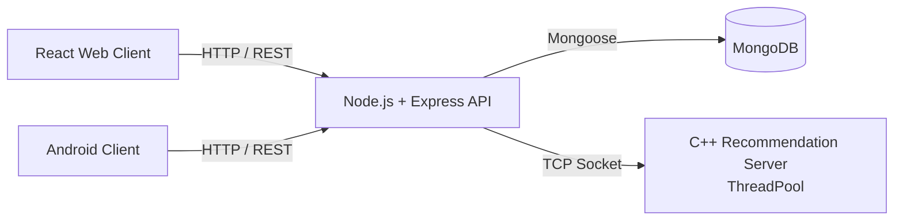

# Netflix-Like Streaming Platform

A full-stack, multi-client movie streaming and recommendation platform. The system lets users register, browse movies by category, search, watch trailers and get personalized recommendations, through both a **React web app** and a native **Android app**. Under the hood it runs as a set of Dockerized services: a Node.js REST API, a MongoDB database, and a dedicated **multi-threaded C++ recommendation server**.

---

## Key Features

- **Two clients, one backend:** a React web client and a native Android client (Java) consume the same REST API.
- **Personalized recommendations:** a standalone C++ recommendation engine suggests movies based on users' watch history, communicating with the API server over TCP sockets.
- **Concurrent request handling:** the recommendation server handles multiple clients in parallel using a custom ThreadPool.
- **Secure authentication:** JWT-based login and registration, with role-based access control (regular users vs. admins).
- **Admin dashboard:** admins can create, edit and delete movies and categories, including uploading media files.
- **Search & browsing:** full-text movie search, browsing by category, movie details page and a built-in video player.
- **Dark / Light mode:** theme toggle on both clients, persisted across sessions.
- **Fully containerized:** every service runs in its own Docker container, orchestrated with Docker Compose.

---

## Tech Stack

| Layer | Technologies |
|---|---|
| **Web Client** | React, JavaScript, CSS |
| **Android Client** | Java, Retrofit, Android Studio |
| **API Server** | Node.js, Express.js, JWT |
| **Recommendation Engine** | C++, TCP Sockets, Multithreading (ThreadPool), CMake |
| **Database** | MongoDB |
| **Infrastructure** | Docker, Docker Compose |

---

## Architecture



- **API Server (`server/api`)** is the single entry point for both clients. It handles authentication, users, movies and categories, and stores data in MongoDB.
- **Recommendation Server (`server/src`)** is a separate C++ service. The API server forwards watch-history updates and recommendation requests to it over a socket connection.
- **Clients (`web`, `android`)** only talk to the API server over HTTP, so the backend can evolve independently of the UI.

---

## API Overview

All authenticated routes require a valid JWT.

| Endpoint | Method | Description |
|---|---|---|
| `/api/users` | POST | Register a new user (name, profile picture, etc.) |
| `/api/users/:id` | GET | Get user details |
| `/api/tokens` | POST | Log in and receive a JWT |
| `/api/categories` | GET / POST | List all categories / create a category (admin) |
| `/api/categories/:id` | GET / PATCH / DELETE | Get, update or delete a category |
| `/api/movies` | GET / POST | Get movies grouped by category / create a movie (admin) |
| `/api/movies/allmovies` | GET | Get all movies |
| `/api/movies/:id` | GET / PUT / DELETE | Get, update or delete a movie |
| `/api/movies/:id/recommend` | GET | Get recommended movies for a given movie |
| `/api/movies/:id/recommend` | POST | Add a movie to the user's watch history |
| `/api/movies/search/:query` | GET | Search movies |

---

## Getting Started

### Prerequisites

- [Docker](https://www.docker.com/) and Docker Compose
- MongoDB running locally on port `27017`
- [Android Studio](https://developer.android.com/studio) (only for the Android client)

### 1. Configure environment variables

Create the file `server/api/config/.env.local` with the following content:

```bash
CONNECTION_STRING=mongodb://host.docker.internal:27017/api
PORT=12345
RECCOMENDATION_IP=netflix-project
RECCOMENDATION_PORT=8080
JWT_KEY=<your-secret-key>
```

### 2. Build the containers

From the project root:

```bash
docker-compose build
```

If you have run the project before, clean up first:

```bash
docker-compose down --remove-orphans
```

### 3. Run the services

Run each service in its own terminal, in this order:

```bash
# Recommendation server
docker-compose run -it -v netflix:/usr/src/mytest/data --rm --name netflix-project server 8080

# API server
docker-compose run -it --rm --name app -p 12345:12345 -v mongo_data:/usr/src/data api

# React web client
docker-compose run -it --rm --name netflix-web -p 3000:3000 web
```

The web app is then available at **http://localhost:3000**.

### 4. Run the Android client (optional)

1. Open the `android` folder in Android Studio and sync the project.
2. Create an emulator (e.g. Pixel 2, API 30) and run the app.
3. The API server address is configured in the `MyApplication` file.

> **Admin access:** admin users are defined manually in MongoDB. After logging in again, an admin user gets access to the management dashboard.

---

## Screenshots

### Web

| Landing Page | Home (logged in) |
|---|---|
|  |  |

| Movie Details & Recommendations | Video Player |
|---|---|
|  |  |

| Search | Admin Dashboard |
|---|---|
|  |  |

| Light Mode | Registration Validation |
|---|---|
|  |  |

### Android

| Home | Movie Details | Search | Light Mode |
|---|---|---|---|
|  |  |  |  |

More screenshots: [Web walkthrough](Wiki/Running%20Examples%20-%20Web.md) · [Android walkthrough](Wiki/Running%20Examples%20-%20Android.md)

---

## Project Structure

```
├── server/
│   ├── api/        # Node.js + Express REST API
│   └── src/        # C++ recommendation server
├── web/            # React web client
├── android/        # Android client (Java)
├── Wiki/           # Detailed docs and screenshot walkthroughs
└── docker-compose.yml
```
